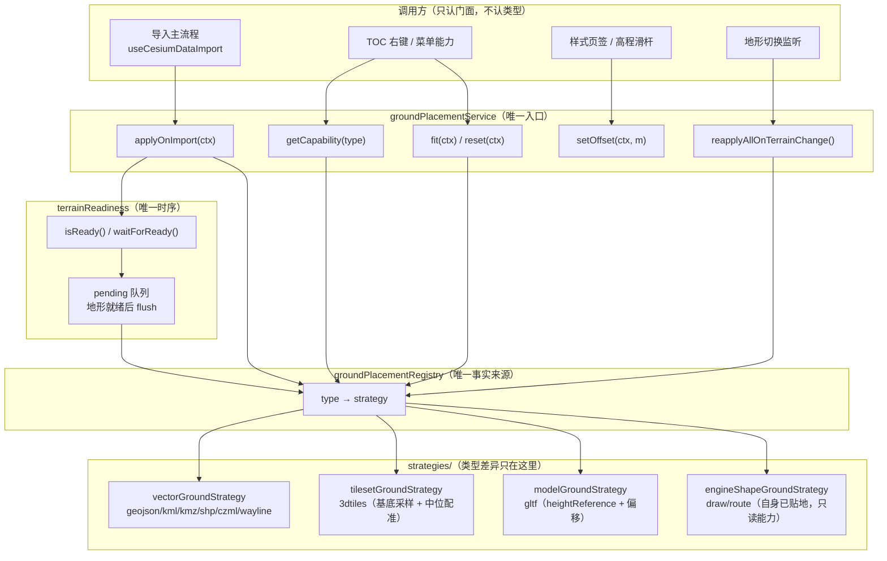

# Cesium 贴地逻辑统一化方案（Ground Placement Unification Plan）

> **任务等级**：L3（跨模块重构 · 架构约定确立）
> **提出背景**：用户反馈「不同数据的贴地逻辑各不相同、混乱、难维护难扩展，且直接影响用户体验（数据埋地看不见）」。
> **状态**：**已实施 P0+P1+P2**（2026-10-25 V3.6.27，用户批准方案 A；P3 清理另行收尾）
> **关联**：`Docs/LLM_record/26-10/2026-10-25/2026-10-25-cesium-draw-measure-full-migration.md`（§10 建档排查、§12 地形缺口修补）

---

## 1. 现状审计（量化）

```
grep -c clampToGround      → 63 处 / 12 个文件
grep -c heightReference    → 40 处 / 10 个文件
合计 103 处散落点，14 个文件
```

**贴地入口函数（语义重叠，实现各异）**

| # | 入口 | 位置 | 职责 |
|---|---|---|---|
| 1 | `isTerrainEnabled` | `terrain/terrainClampService.js:25` | 地形就绪判定（被多处各自调用） |
| 2 | `clampEntityToGround` | 同上 `:58` | 单实体贴地 |
| 3 | `clampDataSourceToGround` | 同上 `:182` | DataSource 批量贴地（地形未开时**静默返回 0**） |
| 4 | `forceDataSourceClampToGround` | `dataImport/loaders/utils.js:174` | KML 的「第二道保险」，与 #3 语义重叠 |
| 5 | `fitTilesetToTerrain` | `dataImport/loaders/tilesetLoader.js:457` | 3D Tiles 导入期配准 |
| 6 | `refitTilesetToTerrain` | 同上 `:556` | 3D Tiles 地形切换重配准（与 #5 大量重复） |
| 7 | `fitLayerToTerrain` / `resetLayerTerrainFit` | `terrain/terrainFitService.js:87/122` | 上一轮新增的「按类型分派」——**已是门面雏形，但仍与 #1–#6 并存** |
| 8 | `setModelHeightOffset` | `dataImport/loaders/gltfLoader.js:340` | glTF 高程偏移 |

**各类型的实际贴地机制（5 套不同做法）**

| 类型 | 加载期 | 后置 | 地形切换 | 手动 |
|---|---|---|---|---|
| geojson | `clampToGround: true` | — | 官方自动跟随 | 无 |
| kml / kmz | `clampToGround: true` | `forceDataSourceClampToGround` 双保险 | 官方自动跟随 | 无 |
| shp | `clampToGround: true` | — | 官方自动跟随 | 无 |
| czml | — | `clampDataSourceToGround` | 官方自动跟随 | 无 |
| 3dtiles | `fitTilesetToTerrain`（基底采样 + 中位配准） | — | `refitTilesetToTerrain` | 高程滑杆 |
| gltf | `heightReference`（CLAMP / RELATIVE） | — | 官方自动跟随 | 高程滑杆（偏移） |
| draw / route | 实体级 `clampToGround` / `classificationType` | — | 官方自动跟随 | 无 |

## 2. 根因（为什么必然越改越乱）

1. **贴地是「加载的副作用」，不是一等公民**。每个 loader 在自己的加载流程里顺手写贴地，没有统一契约，新增格式只能靠复制粘贴。
2. **能力判据散落四处**。`isTerrainEnabled`、`canFitToTerrain`、`nodeBuilder.actions.fitTerrain`、`nodeBuilder.actions.setHeight` 各自判断类型，新增类型必须同步改 4 个地方，漏一个就出现「菜单有按钮但点了没反应」。
3. **时序无人统管**。地形 provider 是异步就绪的，每个调用点各自 `try`；`clampDataSourceToGround` 在地形未就绪时**静默返回 0**，于是「导入成功但看不见」——上一轮补的 watcher 只是把矢量补做塞进 3D Tiles 的监听里，属补丁而非机制。
4. **自动入口与手动入口是两套代码**。`fitTilesetToTerrain` / `refitTilesetToTerrain`、`clampDataSourceToGround` / `forceDataSourceClampToGround` 语义重叠、实现不同，改一处必漏另一处。
5. **无能力自描述**。TOC 菜单、样式页签、高程滑杆全靠手写 `if (is3DTiles)`，类型一多就是排列组合。

## 3. 目标架构

**一句话**：把「贴地」抽成**策略模式 + 统一门面 + 统一时序**，类型差异下沉到策略实现，上层只认契约。



### 3.1 策略契约（草案）

```js
/**
 * @typedef {'auto'|'manual'|'none'} GroundMode
 *   auto   导入即自动贴地（矢量 / glTF）
 *   manual 需用户显式触发（3D Tiles：配准依赖采样，失败要让用户重试）
 *   none   无高程语义（tif / imagery）
 *
 * @typedef {object} GroundCapability
 * @property {string[]} types        负责的类型
 * @property {GroundMode} mode
 * @property {boolean} supportsFit   能否「贴合地形」
 * @property {boolean} supportsReset 能否「恢复原始高程」
 * @property {boolean} supportsOffset 是否提供高程偏移
 * @property {{min:number,max:number}} [offsetRange]
 *
 * @typedef {object} GroundStrategy
 * @property {GroundCapability} capability
 * @property {(ctx: GroundCtx) => Promise<GroundResult>} fit
 * @property {(ctx: GroundCtx) => GroundResult} reset
 * @property {(ctx: GroundCtx, meters: number|null) => GroundResult} [setOffset]
 * @property {(ctx: GroundCtx) => number} [getOffset]
 */

/** @typedef {object} GroundCtx
 *  @property {object} record  loadedDataSources 记录
 *  @property {object} viewer
 *  @property {object} Cesium
 *  @property {object} [options] 策略私有参数
 */

/** @typedef {object} GroundResult
 *  @property {boolean} ok
 *  @property {'ok'|'unsupported'|'terrain-off'|'no-handle'|'sample-failed'|'deferred'} reason
 *  @property {object} [detail]
 */
```

### 3.2 门面 API

| 方法 | 用途 | 替代的旧入口 |
|---|---|---|
| `applyOnImport(ctx)` | 导入期自动贴地；地形未就绪 → 入队并返回 `deferred` | loader 内的 `clampToGround` / `heightReference` / `fitTilesetToTerrain` |
| `fit(ctx)` | 手动贴合 | `fitLayerToTerrain` + `refitTilesetToTerrain` |
| `reset(ctx)` | 恢复原始 | `resetLayerTerrainFit` |
| `setOffset(ctx, m)` / `getOffset(ctx)` | 高程滑杆 | `setModelHeightOffset` + `_rsvcSetHeight` |
| `getCapability(type)` | 能力自描述 | `nodeBuilder` 里手写的 `fitTerrain` / `setHeight` / `attribute` 判断 |
| `reapplyAllOnTerrainChange(ctx)` | 地形切换统一补做 | `useCesiumDataImport` 里的 watcher 分支 |
| `flushPending(ctx)` | 队列冲刷 | 无（当前靠 watcher 偶然补到） |

## 4. 分批实施计划

### P0 · 契约与策略搬家（零行为变更）
- 新增 `terrain/groundPlacement.js`（契约常量 + 结果码）、`groundPlacementRegistry.js`、`strategies/*.js` ×4。
- 把现有实现**原样搬入**策略：`clampDataSourceToGround` → vector 策略；`fitTilesetToTerrain`/`refitTilesetToTerrain` → tileset 策略（**只包一层，不改内部**）；`setModelHeightOffset` → model 策略；draw/route 只声明能力（`supportsFit:false`）。
- 旧函数保留为 thin wrapper 并标 `@deprecated`，**调用方一行不改**。
- 验收：`tsc` / `build` / 5 类数据导入行为与改动前完全一致。

### P1 · 统一导入入口与时序
- `useCesiumDataImport` 在 record 入列后统一调 `applyOnImport`；4 个 loader 删除各自的贴地副作用（geojson/kml/shp 的 `clampToGround` 选项、czml 的 `clampDataSourceToGround`、gltf 的 heightReference 分支）。
- 新增 `terrainReadiness`：`isReady()` / `waitForReady()` / `pending` 队列；`terrainProviderChanged` 改为 `reapplyAllOnTerrainChange` + `flushPending`。
- 验收：**在椭球地形下导入 5 类数据 → 切到真实地形 → 全部自动贴合**（当前矢量已修，此步统一为机制）。

### P2 · 能力自描述与 UI 收敛
- `cesiumLayerNodeBuilder` 的 `fitTerrain` / `resetTerrain` / `setHeight` 改读 `getCapability(type)`；`heightRange` 由策略提供。
- `CesiumContainer` adapter 只转发门面，删除 `terrainFitService` 直连。
- 验收：新增一种数据类型时，**只写一个策略文件 + 一行注册**，TOC 菜单 / 样式页签 / 高程滑杆自动出现。

### P3 · 清理与防回归
- 删除 `@deprecated` wrapper 与 `forceDataSourceClampToGround`（并入 vector 策略）。
- 启动自检：已注册类型集合 vs `TERRAIN_FIT_TYPES` 不一致时 `console.warn`。
- 结构树 / CHANGELOG / README 同步。

## 5. 迁移映射表

| 旧入口 | 新归属 | 处置 |
|---|---|---|
| `terrainClampService.isTerrainEnabled` | `terrainReadiness.isReady` | P2 后删除 |
| `terrainClampService.clampEntityToGround` | `strategies/vectorGroundStrategy` | P3 删除 |
| `terrainClampService.clampDataSourceToGround` | 同上 | P3 删除 |
| `loaders/utils.forceDataSourceClampToGround` | 同上（合并） | P3 删除 |
| `tilesetLoader.fitTilesetToTerrain` | `strategies/tilesetGroundStrategy` | 保留为内部实现 |
| `tilesetLoader.refitTilesetToTerrain` | 同上（与 fit 合一） | P2 合并 |
| `terrainFitService.*` | `groundPlacementService` | P2 删除 |
| `gltfLoader.setModelHeightOffset` | `strategies/modelGroundStrategy` | 保留为内部实现 |
| loader 内 `clampToGround: true` | `applyOnImport` | P1 删除 |
| `nodeBuilder` 手写 `fitTerrain/setHeight` | `getCapability(type)` | P2 替换 |

## 6. 风险与回滚

| 风险 | 影响 | 缓解 |
|---|---|---|
| 3D Tiles 配准逻辑复杂（~700 行） | 搬家即回归 | **P0 只包一层不改内部**，行为由回归验证锁定 |
| 导入期行为变更（loader 不再自己贴地） | 某类数据可能漏贴 | P1 逐类型回归 5 类数据，且 `applyOnImport` 对未注册类型显式 warn |
| 时序：`applyOnImport` 必须在 record 入列后调用 | 队列扫不到记录 | 门面内部校验 `record` 已在 `loadedDataSources` 中，否则 warn |
| 双入口并存期（P0）语义漂移 | 新旧不一致 | wrapper 只转发，不保留第二套实现 |
| 回滚 | — | P0 纯新增文件，删除即回滚；P1/P2 每个阶段独立提交、独立可回滚 |

## 7. 验收标准

1. 全局 `isTerrainEnabled` 调用点 **= 1**（仅 `terrainReadiness` 内）。
2. 全局直写 `clampToGround` / `heightReference` 的位置 **≤ 4**（4 个策略内部）。
3. 新增数据类型贴地接入成本：**1 个策略文件 + 1 行注册**，UI 自动适配。
4. 5 类数据（geojson / kml / czml / 3dtiles / gltf）导入 + 地形切换回归通过。
5. TOC 菜单项与实际能力 **100% 一致**（不再出现「有按钮但点了没反应」）。

## 8. 批准请求

请裁决实施范围：

- **方案 A（推荐）**：P0 + P1 + P2 —— 完成契约、统一时序、能力自描述，达成验收标准 1/3/5；P3 清理另行收尾。
- **方案 B（最小）**：仅 P0 —— 先建立契约与策略骨架，行为零变更，后续再逐步切换。
- **方案 C（全量）**：P0–P3 一次做完，含删除旧入口与防回归自检。
- **方案 D**：暂不动代码，仅保留本方案备查。
