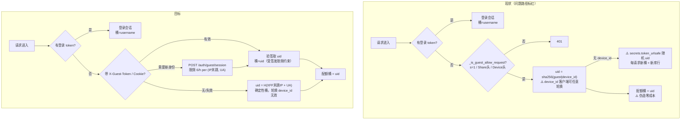
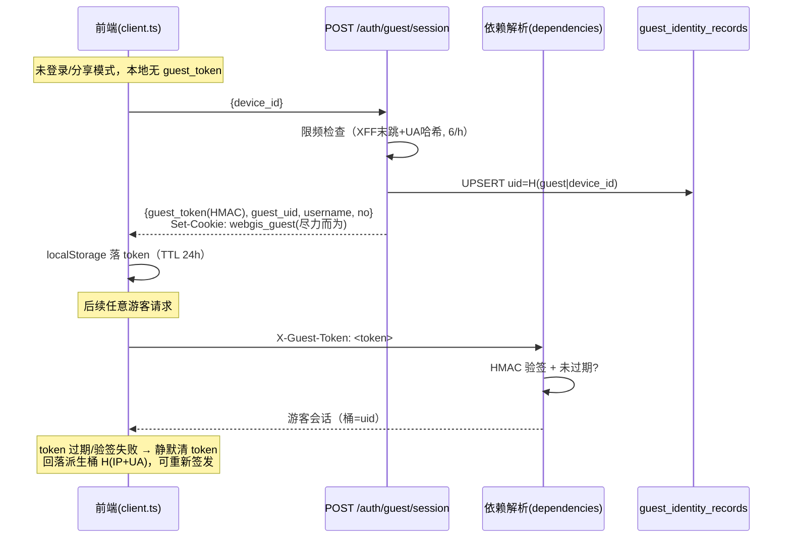
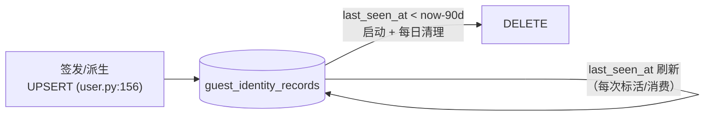

# 游客身份治理方案（分享模式旁路 / 配额伪造 / 随机 uid 洪泛）

> **状态**：🔵 实施中（2026-11-21 V3.7.6 已按批准方案全量落地：后端+前端+单测 40 绿+双门禁全绿；**实机八步验证清单待用户执行**，见维护日志「测试方案」表——含 HF Secrets 配置 `GUEST_TOKEN_SECRET` 前置项）
> **日期**：2026-11-21
> **任务等级**：L3（鉴权行为变更，涉新增端点、依赖拆分、新配置 key）
> **关联登记**：`bugfix-optimization-plan.md` P1-4 三项（分享模式旁路 / Agent 配额伪造 / 游客 uid 随机回退）
> **范围**：`backend/api/auth/*`、`backend/api/statistics.py`、`backend/api/realtime_stats.py`、`frontend/src/api/backend/client.ts`、`frontend/src/domains/common/user/**`。**不含**代理 SSRF 加固（另行 L3）、管理员接口脱敏（另行 L2）。

---

## 1. 问题实证（当前代码，2026-11-21 读码核实）

### 1.1 分享模式旁路：`require_login` fail-open

`api/auth/constants.py:415-433` 的 `_is_guest_allow_request()` 在「URL `?s=1` / `X-Share-Mode` / `X-Guest-Allow` 头 / `X-Guest-Device-Id` 头」任一命中即放行；`api/auth/dependencies.py:132-142` 中 `require_login` 无 token 时据此**不抛 401 而是铸造临时游客会话**。后果：**全部 18 个**声明 `Depends(require_login)` 的端点（`/auth/me`、`/change-password`、`/oauth/*/bind*`、`/statistics/center`…）实际语义都是「登录或游客」。V3.6.6 已收窄一半（过期 token + 显式凭据头不再降级游客，`dependencies.py:153-161`），但「裸无 token + `?s=1`」通路原样存在。

### 1.2 配额主体伪造：身份种子 100% 客户端可控

游客配额桶 = `guest_uid = sha256("guest|" + device_id)`（`constants.py:138-147`），而 `device_id` 来自请求头 `X-Guest-Device-Id`（`dependencies.py:85-88`，无任何服务端校验）。**每请求轮换该头 = 每请求一个全新每日额度池**。AI 对话走平台 Key 调上游 LLM，配额绕过即真金白银流失（P1 定级的主因）。

### 1.3 随机 uid 回退：无 device-id 时身份无限铸造

`constants.py:142-144`：`if not seed_device_id: seed_device_id = secrets.token_urlsafe(10)`。无设备头的请求（尤其 `?s=1`）→ 每请求新 uid → `user.py:156` `_get_or_create_guest_username_sync` 每请求插一行 `guest_identity_records` → ① 表无界增长（HF 容器盘）；② 每请求新配额桶；③ 在线统计灌垃圾身份。

### 1.4 已核实的现状事实（设计前提）

| 事实 | 出处 | 对方案的意义 |
|---|---|---|
| 配额扣减已原子化（`INSERT … ON CONFLICT … RETURNING` + 超限封顶） | `quota.py:81-114` | 消费侧无需再改，治理面收敛到**身份侧** |
| Agent 预检快照非原子，靠封顶兜底 | `agent_chat/routes.py:152-155,275` | 保留不动（预检只为省上游调用） |
| Agent 对话为「先交付后扣费」 | `quota.py:96-100` 注释 | 封顶语义是刻意设计，不改 |
| 前端**未登录也恒发** `X-Guest-Device-Id` | `client.ts:99-103` | 派生兜底路径会覆盖绝大多数真实游客 |
| 分享模式前端造的是**本地伪 token**（`guest_<ts>_<dev>`），后端不验 | `auth.ts:299-340` | 改造点：改调真实签发端点 |
| `_extract_client_ip` 自述「不是信任边界」，且优先读客户端可写的 `X-Client-IP` | `constants.py:359-383` | 身份派生不能用现函数，需取 XFF **末跳** |
| SSE 凭一次性 ticket 建连，EventSource 无法带头 | `useRealtimeStats.ts:132-159` | ticket 端点并入重分类即可，SSE 协议不动 |
| 生产为 GitHub Pages（`webgis.negiao.cn`）→ HF Space（`*.hf.space`）**跨站** | 部署事实 | **HttpOnly Cookie 在生产跨站不可靠（ITP/第三方 Cookie 封杀），主通道必须是「签发 token + 请求头」**，Cookie 仅尽力而为 |

## 2. 目标与非目标

**目标**
1. `require_login` 恢复 fail-closed 语义；游客可达端点显式化（依赖名即语义）。
2. 匿名身份**铸造受限**：新身份的唯一入口是签发端点，按「IP 末跳 + UA」限频；伪造 device_id 不再直接产生新配额桶。
3. 废除随机 uid 回退；无 token 流量收敛到确定性派生桶（`H(末跳IP+UA)`）。
4. `guest_identity_records` 有界（90 天保留期清理）。
5. 游客可见行为不回归：在线统计、分享模式、AI 对话限额提示均保持现有体验。

**非目标**（明确排除）
- 不改代理/SSRF 面（`P1-4` 首项另行 L3）。
- 不改管理员表浏览器/密钥回显（另行 L2 掩码化）。
- 不做验证码/PoW（HF 红线敏感区，且对真实游客伤害大）。
- 不追求「根绝」匿名滥用——匿名流量没有不可伪造的信任锚，本方案交付的是**把绕过成本从「每请求 0 成本」抬升到「受签发限频约束 + 需同时轮换 IP 与 UA」**。同域部署（API 挂到 `webgis.negiao.cn` 同源）后的 Cookie 信任锚列为 Phase 2 预留。

## 3. 方案设计

### 3.1 依赖拆分：`require_login` 收回 fail-closed

**规则**：游客可达的端点一律显式改名；`require_login` 本体删除游客兜底分支（`dependencies.py:133-137` 与 `:157-161`），无有效 token 一律 401（`GUEST_NO_TOKEN` → 改为 `LOGIN_REQUIRED`，前端既有 401 分支已区分这两码，`client.ts:201-205`）。

18 个 `require_login` 端点的重分类（**待批准核心表**）：

| 端点 | 现依赖 | 改为 | 理由 |
|---|---|---|---|
| `GET /auth/me` | require_login | `or_guest_noconsume` | 未登录访客面板挂载即调（`FloatingAccountPanel` mount），改 fail-closed 会被拦截器弹登录跳转，回归 |
| `GET /statistics/center` | require_login | `or_guest_noconsume` | 同上，15s 轮询 |
| `GET /statistics/realtime` | require_login | `or_guest_noconsume` | 同上 |
| `GET /statistics/messages` | require_login | `or_guest_noconsume` | 面板页签懒加载 |
| `GET /announcement/current` | require_login | `or_guest_noconsume` | 公告属公共信息 |
| `POST /announcement/dismiss` | require_login | `or_guest_noconsume` | 前端弹窗关闭即调 |
| `GET /statistics/ticket` | require_login | `or_guest_noconsume` | 游客 SSE 入口（ticket 随后换身份） |
| `POST /statistics/heartbeat` | require_login | `or_guest_noconsume` | 在线标活，游客参与在线统计（现状如此） |
| `GET /auth/download-quota/estimate` | require_login | `or_guest_noconsume` | 下载面板游客可打开（估算不改配额） |
| `POST /auth/change-password` | require_login | **require_login（fail-closed）** | 账号操作，游客无意义 |
| `POST /auth/change-avatar` | require_login | **require_login** | 同上 |
| `POST /auth/change-display-name` | require_login | **require_login** | 同上 |
| `POST /auth/bind-email` | require_login | **require_login** | 同上 |
| `GET /auth/preferences` / `POST /auth/preferences` | require_login | **require_login** | 游客无偏好存取（前端已静默 catch 401） |
| `GET /oauth/accounts`、`/oauth/*/bind/start|complete`、`DELETE /oauth/*/bind` | require_login | **require_login** | 账号绑定，游客无意义 |
| `POST /auth/logout`（`require_login_for_logout`） | 不动 | 不动 | 注销对游客无害，维持 |

> `or_guest_noconsume` 即现有 `require_api_access_or_guest_noconsume`（`dependencies.py:297-300`，只认证不扣配额），复用不新建。**统计/面板类端点不能换到扣配额的 or_guest 变体**——否则 15s 轮询会把游客额度刷光。

### 3.2 服务端签发游客身份（方案核心）

新增 `POST /api/auth/guest/session`：

- **入参**（可选）：`device_id`（客户端稳定设备 ID，localStorage 已有）。
- **身份解析**：请求已带有效 guest token → 原样续期返回同一 uid（**不计限频**）；否则 `uid = "guest_" + sha256("guest|" + device_id)[:16]`（与现行格式完全一致，统计口径不迁移）。
- **签发物**：`guest_token = base64url(uid + "." + exp + "." + HMAC-SHA256(uid, exp, GUEST_TOKEN_SECRET))`，TTL 24h（L2 可调）；响应 body 返回 `{guest_token, guest_uid, username, guest_no, role, expires_at}`，**同时** `Set-Cookie: webgis_guest=<token>; SameSite=None; Secure; Max-Age=86400`（尽力而为，同源部署后自动成为信任锚）。
- **限频**：新签发（无有效 token 呈递）按键 `(XFF末跳IP, UA哈希)` 限 **6 次/小时**（L2 可调），超限 429 `GUEST_ISSUE_LIMITED`；已持有效 token 的续期不受限。**键不含 device_id**——轮换 device_id 无法绕开限频。
- **验签路径**（`dependencies.py` 改造）：身份解析优先级 = `Authorization` 登录 token → `X-Guest-Token` 头 / Cookie 的 guest token（验签 + 未过期）→ 无 token 时确定性派生（见 3.3）。验签失败不 401，静默落入派生兜底（游客无感重建身份）。

**Secret 来源**：新增 **L3** key `GUEST_TOKEN_SECRET`（HF Secrets / 本地 `.env`；禁入仓库）。**空值降级**：签发端点返回 503 + 启动 warning，依赖解析走派生兜底——即「未配置 = 回到加强前的派生行为」，可用性优先，不因缺 key 拒服务。

### 3.3 无 token 派生兜底：锁死确定性桶

`_build_guest_uid` 改造（`constants.py:138-147`）：

```text
有 device_id 且请求带有效 guest token  →  token 内 uid（签名保障）
有 device_id、无 token（兼容旧客户端）  →  H(末跳IP + "|" + UA)     ← 改动点：device_id 不参与桶
无 device_id                          →  H(末跳IP + "|" + UA)     ← 废除 secrets.token_urlsafe 随机
```

- 「无 token」时 device_id **不参与桶派生**是关键：轮换 `X-Guest-Device-Id` 不再产生新桶（桶锁死在 IP+UA 维度）。
- IP 用 **XFF 末跳**（HF 反代追加的那跳），不读客户端可写的 `X-Client-IP`/XFF 首跳——新增 `_extract_identity_ip()`，与现有展示用 `_extract_client_ip` 分离，后者不动。
- 诚实声明：UA/IP 均可伪造（换 UA 或换出口 IP 可再绕），此路径只是**防洪**（意外无头流量收敛）；**防绕**主力是 3.2 的限频签发。两条路合起来把绕过成本从 0 抬到「每 10 分钟 6 个新桶 + 需同时换 IP/UA」。
- uid 格式不变（`guest_<hex16>`）→ `guest_identity_records` / 在线统计 / 管理面板展示**零迁移**。

### 3.4 `guest_identity_records` 生命周期

- 启动时 + 每日定时：`DELETE FROM guest_identity_records WHERE last_seen_at < now - 90d`（L2 `GUEST_IDENTITY_RETENTION_DAYS`）。
- 派生/签发写入复用现有 UPSERT（`user.py:156`），不动 schema——**无数据库结构变更**。

### 3.5 前端改造

| 位置 | 改动 |
|---|---|
| `client.ts` 拦截器 | 无 Authorization 时附 `X-Guest-Token`（localStorage `webgis_guest_token`）；`GUEST_TOKEN_INVALID` 类 401 静默清 token，不弹窗 |
| 新增 `ensureGuestSession()`（auth 服务） | 应用启动 / 分享模式注入 / 收到无 token 响应时调 `POST /auth/guest/session` 拉取并落 token + 本地 user 对象（替代现 `injectGuestTokenForShareMode` 的伪 token，`auth.ts:299-340`） |
| `useRealtimeStats.ts` | ticket 请求经拦截器自动带 guest token；SSE URL 协议不变 |
| `getBackendBearerToken()` | 游客伪 token 抑制逻辑（`auth.ts:93-103`）随伪 token 一并废除 |
| 401 文案 | `GUEST_NO_TOKEN` 改码为 `LOGIN_REQUIRED` 后，`client.ts:201-205` 的差异化分支同步 |

### 3.6 配置 key 登记（前置义务 §3）

| key | 级别 | 默认 | 说明 |
|---|---|---|---|
| `GUEST_TOKEN_SECRET` | L3 | 空 | 空 = 签发通道关闭（503），解析走派生兜底 |
| `GUEST_TOKEN_TTL_HOURS` | L2 | 24 | token 有效期 |
| `GUEST_ISSUE_RATE_PER_HOUR` | L2 | 6 | 每 (末跳IP, UA) 每小时新签发上限 |
| `GUEST_IDENTITY_RETENTION_DAYS` | L2 | 90 | 游客记录保留期 |

登记顺序：`deploy/.env.example` + `backend/config/catalog.py` → 读代码 → `CheckConfigRegistry.py`。

## 4. 架构图（L3 必备）

### 4.1 身份判定流：现状 vs 目标



### 4.2 游客身份签发与使用时序



### 4.3 游客记录生命周期



## 5. 兼容性与迁移

- **数据库**：无 schema 变更；`guest_identity_records` 现行 UPSERT 复用；uid 格式不变 → 管理面板/统计/在线列表零迁移。
- **统计口径**：唯一会跳变的是「无 device-id 访客」从每请求一个身份变为每 (IP,UA) 一个——该流量本就是 1.3 的垃圾洪泛，跳变即修复效果本身，日志中说明即可。
- **旧客户端窗口**：方案后端对「带 device-id 头但无 token」的请求仍返回游客会话（派生桶），前端未升级不会断功能；新前端上线后自然迁移到签发通道。**无需双读期**。
- **本地开发**：`GUEST_TOKEN_SECRET` 未配置时功能降级不报错；`deploy/.env.example` 给出非密占位说明。

## 6. 风险与权衡（如实）

| 风险 | 评估 | 缓解 |
|---|---|---|
| 限频误伤共享网络（校园/CGNAT） | 真实存在：同出口 IP 多人首次访问集中时可能 429 | 阈值 L2 可调；429 文案引导「登录后不限」；登录用户完全不受影响 |
| token 落 localStorage 有 XSS 面 | 与现有登录 token（sessionStorage）同级 | 接受；token 权限仅为游客配额，损失有界 |
| UA/IP 可伪造仍可绕 | 本方案是成本抬升非根绝（§2 非目标已声明） | Phase 2：同域部署后启用 Cookie 信任锚 + per-IP 全局备选闸（另行立项） |
| 签发端点本身被 DDoS | 新增公开端点即新增攻击面 | 限频即挡板；503/429 均为轻量响应；无库写（限频计数内存 + 落库节流） |
| `require_login` 收紧后未知调用方回归 | 18 端点已逐一重分类，但可能有前端遗漏调用点 | 实施时全局 grep 前端 API 调用清单逐一对表；401 分支前端均已静默/引导，无崩溃路径 |

## 7. 实施步骤（批准后执行，拟分 2 个会话）

**Phase A（后端，L2 级改动面，走全流程日志+版本）**
1. 配置 key 四项登记 → `catalog.py` / `.env.example` / `CheckConfigRegistry.py` 全绿。
2. `constants.py`：`_build_guest_uid` 派生改造 + `_extract_identity_ip()`（XFF 末跳）。
3. 新增 `guest_token.py`（HMAC 签发/验签 + 限频器，单一职责新文件 `.py` 后端惯例）。
4. 新增 `POST /auth/guest/session` 端点。
5. `dependencies.py`：`require_login` 删游客兜底；§3.1 表逐端点换依赖。
6. `user.py` / 启动钩子：90 天清理任务。
7. 单测（pytest）：签发/验签/过期/篡改/限频/派生兜底/purge/18 端点重分类回归。

**Phase B（前端 + 收尾，独立会话）**
1. `client.ts` 拦截器 + `ensureGuestSession()` + 分享模式注入改造 + 401 码分支。
2. `useRealtimeStats.ts` 适配核验。
3. `vue-tsc` / `eslint` / 双门禁 / §11.2 红线自查（后端涉改，必跑）。
4. 实机验证清单交用户。

**验收清单**
- [ ] 匿名轮换 `X-Guest-Device-Id` 100 次 → 配额桶不再增长（派生桶恒定），`guest_identity_records` 不再每请求增行
- [ ] 签发限频：同 (IP,UA) 第 7 次/小时新签发 → 429；持有效 token 续期不受限
- [ ] 篡改/过期 token → 静默落派生桶，游客功能不中断
- [ ] 未登录访客：首页/面板/公告/在线统计/AI 对话限额提示全链路不回归
- [ ] 分享模式 `?s=1` 链接打开 → 真实签发身份，统计计入
- [ ] 登录用户 18 端点行为零变化；管理员不受影响
- [ ] `GUEST_TOKEN_SECRET` 未配置环境：功能降级可跑 + 启动警告
- [ ] 双门禁 + §11.2 红线全绿

## 8. 待用户决策点

1. **§3.1 重分类表整体批准？**（尤其 9 个转 `or_guest_noconsume` 的端点——它们当前实际就在被游客使用，本表只是把语义显式化）
2. **限频基线 6 次/小时/(IP,UA)** 是否合适？（可先宽松后收紧）
3. **90 天保留期**是否合适？
4. **Phase A/B 分两个会话**（每会话独立版本号+日志），还是合并单会话一次交付？
