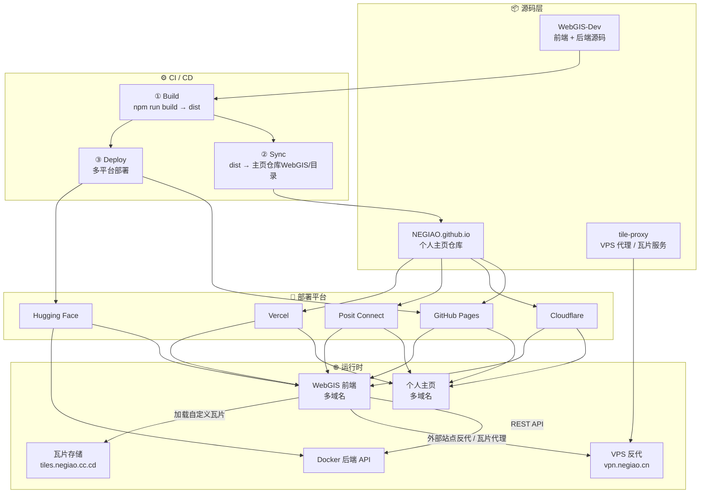

<p align="center">
  <a href="./README.md">🇨🇳 中文</a> | <a href="./Docs/README_EN.md">🇬🇧 English</a>
</p>

<h1 align="center">NEGIAO's WebGIS</h1> 

<p align="center">
  <em>专业级前后端分离 WebGIS 平台 · Vue 3 + OpenLayers + Cesium + FastAPI</em>
</p>

<p align="center">
  <a href="https://vuejs.org/"></a>
  <a href="https://vite.dev/"></a>
  <a href="https://openlayers.org/"></a>
  <a href="https://cesium.com/"></a>
  <a href="https://fastapi.tiangolo.com/"></a>
  <a href="https://rapier.rs/"></a>
  <a href="https://pages.github.com/"></a>
  <a href="https://www.docker.com/"></a>
  <a href="https://huggingface.co/"></a>
  <a href="#-许可证"></a>
</p>

<p align="center">
  🚀 <strong>在线演示</strong>：<a href="https://webgis.negiao.cn">NEGIAO's WebGIS-Dev — 欢迎点击体验</a>
</p>

<p align="center">
  
  
  
  
  <a href="https://github.com/NEGIAO/WebGIS-Dev/stargazers"></a>
  <a href="https://github.com/NEGIAO/WebGIS-Dev/forks"></a>
</p>

---

## 🌟 核心功能预览

<div align="center">

| **🗺️ 底图卷帘对比** | **🧭 罗盘寻龙点穴** |
| :---: | :---: |
| <a href="https://github.com/user-attachments/assets/c8cb6f16-04e0-4b9a-983f-22538e0bd65a"></a> | <a href="https://github.com/user-attachments/assets/acbb5a56-bff7-44c3-848b-dbe178c52301"></a> |
| **📐 二维数据管理** | **☁️ 三维漫游云景** |
| <a href="https://github.com/user-attachments/assets/da18b733-8979-4beb-9ac6-c07423b86ba2"></a> | <a href="https://github.com/user-attachments/assets/7bedba67-d965-4640-ac32-f5d75630e434"></a> |
| **🤖 智能助手交互** | **🌊 动态淹没分析** |
| <a href="https://github.com/user-attachments/assets/2dbbb794-ef3e-4d7a-b16b-4f381053fec3"></a> | <a href="https://github.com/user-attachments/assets/e26761db-8f91-4f05-90f2-106b28223ab5"></a> |

<div align="center">🗺️ 矢量瓦片逆向解析</div>


</div>

---

## 📑 目录

- [🌟 核心功能预览](#-核心功能预览)
- [📑 目录](#-目录)
- [🎯 项目简介](#-项目简介)
  - [规模速览](#规模速览)
  - [核心能力 · 地图内核](#核心能力--地图内核)
  - [核心能力 · 三维与分析](#核心能力--三维与分析)
  - [核心能力 · 数据与协作](#核心能力--数据与协作)
  - [核心能力 · 账号与运维](#核心能力--账号与运维)
- [🧰 功能模块全景](#-功能模块全景)
- [🛠️ 技术栈](#️-技术栈)
- [⚠️ 建筑抓取合规声明（必读）](#️-建筑抓取合规声明必读)
- [🚀 快速开始](#-快速开始)
  - [环境要求](#环境要求)
  - [配置（双 env 文件架构，先看这一处）](#配置双-env-文件架构先看这一处)
  - [一键启动（推荐）](#一键启动推荐)
  - [手动启动（高级用户）](#手动启动高级用户)
  - [本地开发镜像](#本地开发镜像)
- [📁 项目结构](#-项目结构)
- [🏗️ 系统架构](#️-系统架构)
  - [分层架构总览](#分层架构总览)
  - [后端 API 面](#后端-api-面)
  - [域名映射](#域名映射)
- [🧭 文档导航](#-文档导航)
  - [开发文档（`Docs/Guide/`）](#开发文档docsguide)
  - [架构文档（`Docs/Architecture/`）](#架构文档docsarchitecture)
- [🚧 已知限制与当前状态](#-已知限制与当前状态)
- [Star History](#star-history)
- [📜 版本演进](#-版本演进)
- [📄 许可证](#-许可证)
- [👤 作者与托管](#-作者与托管)

---

## 🎯 项目简介

**NEGIAO's WebGIS** 是一个功能完整、架构清晰的前后端分离 WebGIS 平台（当前版本 V3.6.26），前端托管于 GitHub Pages（正式域名 webgis.negiao.cn），后端以 Docker 部署在 Hugging Face Spaces，通过 RESTful API 通信，支持独立扩展。

> 📚 本 README 仅保留核心概览与导航。完整文档已模块化至 [`Docs/Guide/`](Docs/Guide/)，详见下方「文档导航」。
>
> 📐 架构文档统一存放于 [`Docs/Architecture/`](Docs/Architecture/)，使用 Mermaid 流程图 / 时序图 / 状态图描述各子系统的模块关系、数据流向与文件交互，供技术交接与方案审查参考。
>
> 🤖 在本仓库使用 AI Agent 协作开发，请先阅读 [`Docs/Force_command.md`](Docs/Force_command.md)（强制执行规范，含红线与门禁）。
>
> 不了解项目全貌？试试 [DeepWiki — 向 LLM 提问本项目](https://deepwiki.com/NEGIAO/WebGIS-Dev) [](https://deepwiki.com/NEGIAO/WebGIS-Dev)

### 规模速览

| 维度 | 实测规模 |
|---|---|
| 前端 | 511 个源文件 / 约 18.5 万行（`.vue` / `.js` / `.ts`），70 个 Vue 单文件组件 |
| 后端 | 70 个 Python 文件 / 约 2.15 万行，15 组 REST 路由 |
| 文档 | `Docs/` 下 549 篇 Markdown（含 `Guide/` 13 篇、`Architecture/` 21 篇、`LLM_record/` 逐次开发记录） |
| 双语文案 | `zh-CN` / `en-US` 各 2000+ 行 i18n，30 个命名空间 |
| CI | 4 条工作流（`deploy` / `pre-check` / `codeql` / `traffic-counter`），`deploy` 内含 5 个 Job |

### 核心能力 · 地图内核

| 领域 | 说明 |
|------|------|
| 🗺️ 2D/3D 双引擎 | OpenLayers 10.5 + Cesium 1.132 一键切换，视图状态双向同步，URL 分享还原 |
| 🌐 丰富底图源 | **90 个底图预设 / 106 个图层定义**：天地图、高德、腾讯、天地图矢量、ESRI（含 Wayback 历史影像）、Sentinel-2 Cloudless、奥维等；熔断回退、GCJ-02/BD-09 纠偏、自定义 XYZ 接入 |
| 🧭 图层管理（TOC） | 统一目录：拖拽排序、行内重命名、显隐/透明度/样式、层级叠放定序、坐标转换（WGS-84 ⇄ GCJ-02）、单层导出（CSV/TXT/GeoJSON/KML）、二维图层导入 3D |
| 📊 属性表 | 视图范围筛选、字段可见性、全字段检索、CSV 导出、要素定位与删除 |
| ✏️ 绘制与测量 | 点/线/面/矩形/椭圆/圆/箭头/风向/军标共 9 类绘制；测距、测面；跨图层顶点编辑 |
| 🔍 地名检索 | 三提供者切换：天地图 / 高德 / Nominatim（国际），支持 POI ID、分页、起终点选点 |
| 🗂️ 行政区划 | 区划树下钻、边界加载、与图层体系共用坐标转换与导出链路 |
| 🎞️ 历史影像 | ESRI Wayback 版本目录（后端 SQLite 缓存 + 前端时序浏览） |
| 🌓 卷帘对比 | 左右底图任选，水平 / 竖直双向滑动 |

### 核心能力 · 三维与分析

| 领域 | 说明 |
|------|------|
| 📥 多格式数据导入 | GeoJSON / JSON / KML / KMZ / SHP（zip 或散件）/ CZML / GLB / GLTF / 3D Tiles（zip）/ GeoTIFF / CSV / GPX；2D/3D 双管线、ZIP 批量分组、`.prj` 投影识别、失败行内可重试 |
| 🏢 建筑白模抓取 | 建筑 1（腾讯）/ 建筑 2（高德）/ 天地图矢量瓦片三类数据源；框选抓取轮廓与楼高、跨瓦片同标识融合、自动入库 TOC |
| 📐 空间分析 | **8 算子**：缓冲区、叠加、泰森多边形、热点聚合、渔网（方格/六边形）、凸包、多环缓冲、几何简化（Shapely 后端精确计算） |
| 🔬 三维分析 | 限高分析、可视域分析（`cesium/modules/analysis`，逐像素/射线两套实现） |
| ✨ 三维特效 | 体积云 ray marching、Bruneton 大气、BSM 云影、风场粒子、流体淹没模拟、浅水叠加、后处理（HBAO / 移轴 / 雾） |
| 🛩️ 面状航线规划 | 测区绘制、弓字形 / 五向倾斜采集、AGL 仿地、DJI KMZ 导入导出，接入统一图层管理 |
| 🚶 人物漫游 | 迁移自 `hh-hang/cesium-player-controller` 并持续对齐上游（当前对应 0.2.1）：Rapier 物理、局部系重锚、贴地修正、第一/第三人称 |
| 🛣️ 路径规划 | 天地图驾车 / 公交双管线，搜索选点与路线渲染 |
| 🎬 第一人称漫游 | 航线飞行（`route-fly`）：沿规划航线第一人称飞行，支持速度/视角控制 |

### 核心能力 · 数据与协作

| 领域 | 说明 |
|------|------|
| 🤖 AI 空间助手 | LLM 集成，**三种接入模式**（管理员默认 Key / 个人 Key / 后端代理）；function-calling 工具（视角、缩放、底图切换等）+ OL/Cesium 双引擎命令适配器，支持多步地图操作 |
| 🧭 风水罗盘 | 罗盘、寻龙点穴、方位叠加（`Docs/Guide/compass-types-note.md`） |
| 🌤️ 天气看板 | 实时天气与图表（Open-Meteo 类公开源，后端代理） |
| 🗞️ 新闻聚合 | 多平台热榜，直连 + 代理双通道竞速、静默刷新与本地缓存兜底 |
| 📢 站点公告 | 管理端下发，首次访问弹条 + 可关闭持久化 |
| 🎨 主题体系 | 设计令牌驱动的多主题（绿/蓝等）自动联动，深浅色与移动端适配 |

### 核心能力 · 账号与运维

| 领域 | 说明 |
|------|------|
| 🔐 账号体系 | 邮箱注册登录、Google / GitHub / Hugging Face OAuth 登录与绑定、**三级身份**（`guest` / `registered` / `admin`）、游客序号 `guest_no`、会话鉴权、双 AI 配额 |
| 🛡️ 管理控制台 | 运行时配置（地图 token、底图、Agent 参数、公告）、API Key 管理、访问统计、在线用户调试 |
| 📈 统计与监控 | 访问日志、UV/PV、实时在线 presence（心跳 + 下线）、SSE 日志流转发、`/statistics/*` 后台看板 |
| 🧰 实用工具集 | 屏幕特效（流体烟雾/引力场/维度塌陷/量子波/黑洞/圆环爆破）、测距测面、坐标拾取、视角分享、鸡汤、常用地点跳转 |

---

## 🧰 功能模块全景

按「引擎域」罗列的模块清单，便于快速定位代码：

**Cesium 工具面板（`cesium/composables/toolModules/`）**

`场景导航` · `大气·光照·天空` · `体积云` · `风场` · `流体淹没` · `浅水叠加` · `人物漫游` · `面状航线` · `航线飞行` · `三维分析（限高/可视域）`

**OpenLayers 工具（`ol/`）**

`绘制 drawing` · `空间分析 spatial-analysis` · `路径规划 routing` · `地名检索 search` · `底图 basemap` · `瓦片源 tile-source` · `行政区划 DistrictManager` · `URL 状态 url-state` · `启动编排 startup`

**公共域（`common/`）**

`侧栏外壳 shell（SidePanel/TopBar/公告条/全局加载）` · `图层树 layer-tree` · `数据导入 data-import` · `AI 对话 chat（agent/工具注册/命令总线）` · `罗盘 compass` · `天气 weather` · `用户与账号 user` · `命令总线 command-bus` · `地图视图 map-view` · `数据协议 data-protocol` · `界面 ui`

**侧栏标签页**（共 8 个，按使用懒加载，首次切到后保持挂载以保留状态）：`新闻热榜`（info 默认页）/ `工具箱` / `驾车规划` / `公交规划` / `风水罗盘` / `建筑抓取` / `天气` / `AI 助手`

---

## 🛠️ 技术栈

| 层 | 选型 |
|---|---|
| 前端框架 | Vue 3.5（Composition API）+ Vite 6.2 + Pinia 2.3 + Vue Router 4.6 |
| 二维地图 | OpenLayers 10.5 |
| 三维地图 | Cesium 1.132（`@cesium/engine`）+ Three.js 0.185（特效辅助） |
| 物理引擎 | `@dimforge/rapier3d-compat` 0.14（人物漫游刚体与碰撞） |
| 后端 | FastAPI ≥0.100（Python 3.12）、Shapely ≥2.0、SQLite 缓存、SSE 日志流 |
| 部署 | GitHub Pages / Cloudflare Pages / Posit Connect / Vercel（前端）；Hugging Face Docker（后端） |
| 质量 | ESLint、`vue/compiler-sfc` 编译校验、`tsc --noEmit`、结构树与配置注册表自检脚本、CodeQL |

---

## ⚠️ 建筑抓取合规声明（必读）

- 仅允许在你已获得官方授权的场景下使用建筑抓取能力；
- 严禁绕过权限、规避访问控制、破解或其他未授权技术手段；
- 严禁批量采集、离线库化、二次分发或用于未授权商用；
- 使用者必须自行遵守数据源服务条款、当地法律法规及平台政策；
- 项目默认提供范围/频率控制与前端合规确认提示，使用者仍需承担最终合规责任。

---

## 🚀 快速开始

### 环境要求

| 依赖 | 要求 | 说明 |
|------|------|------|
| **Node.js** | **20 LTS 及以上**（推荐 20.x / 22.x） | Vite 6 要求 Node 18+，本项目按 20 LTS 验证。仓库未在 `package.json` 声明 `engines` |
| npm | 10+ | 随 Node 20 附带 |
| Docker Desktop | 仅全栈本地联调需要 | 只跑前端 `npm run dev` **不需要** Docker |
| Python | 3.12（容器内 `python:3.12-slim` 已固定） | 后端仅通过 Docker 运行，不支持裸 `uvicorn` |
| LocalDev.bat | Windows 一键启动脚本 | 自动检测上述依赖 |

### 配置（双 env 文件架构，先看这一处）

| 文件 | git 状态 | 用途 | 读取时机 | `APP_ENV` |
|------|----------|------|----------|-----------|
| **`deploy/.env`** | **git 追踪** | 部署环境（生产基线） | `npm run build` + 线上部署 | `production` |
| **`deploy/.env.local`** | **git 追踪** | 本地开发（覆盖 `.env`） | `npm run dev` + 本地后端 | `development` |
| `deploy/.env.example` | git 追踪 | 全集 key 目录（不写真值） | — | — |

**三层密钥分层**（L1/L2/L3）：

| 层 | 放哪里 | 做什么 |
|----|--------|--------|
| **L1** | `deploy/.env` / `.env.local`（不涉密） | URL、端口、前端 `VITE_*`、公开服务端点/超时 |
| **L2** | 管理员面板 + 数据库 | 地图 token、Agent/LLM Key 与参数、底图、公告（常变、动态生效） | 
| **L3** | Hugging Face **Secrets** | 绝密：`SUPER_USER`、OAuth secret、SMTP 密码、Supabase Key、监控令牌 |

说明与检查清单：[Docs/Guide/configuration.md](Docs/Guide/configuration.md) · 全景：[configuration-three-tier.md](Docs/Architecture/configuration-three-tier.md)

```bash
# 仓库根目录：.env（部署环境）与 .env.local（本地开发）双文件架构
# 两个文件都提交 git（L1 不涉密）
# 本地开发：Vite 读 .env.local，后端读 .env.local（覆盖 .env 的 production 值为 localhost）
# 部署构建：Vite 只读 .env（selectiveEnvPlugin 按 mode 二选一）
```

> 代理相关：后端部署在 Hugging Face，其政策**禁止挂载任何 `/proxy/*`、`/tiles/*` 中转**。瓦片代理与外部站点反代由 VPS 上的独立服务（`vpn.negiao.cn`，仓库 `tile-proxy`）承接，前端通过 `VITE_TILE_PROXY_BASE_URL` 拼接 `${base}/proxy/<host>/<path>`。

### 一键启动（推荐）

```bash
# Windows：双击 LocalDev.bat，脚本自动完成：
# 1. 检测环境依赖（Node.js / Docker / docker compose）
# 2. 本地开发环境：前端 Vite 读 .env.local，后端 load.py 读 .env.local（覆盖为 localhost 开发值）
# 3. 智能检测 Docker 镜像状态（首次构建 / 代码热重载 / Dockerfile 变更提示）
# 4. 启动前端开发服务器 → http://localhost:5173
# 5. 自动打开浏览器
```

> `LocalDev.bat` 为纯 ASCII 编码，兼容 GBK/UTF-8 系统；中文彩色输出由同目录 `Write-Color.ps1` 提供。

**访问地址**：前端 http://localhost:5173 · 后端 API 文档 http://localhost:7860/docs

> **本地开发默认管理员**：账号 `admin`，密码 `123456`。仅在 `SUPER_USER` 未配置且 `APP_ENV` 为 `development`/`dev`/`local`/`test` 时生效（`load.py` → `get_admin_password()`）；生产环境必须通过 HF Secrets 配置 `SUPER_USER`，否则管理员登录直接禁用。

### 手动启动（高级用户）

<details>
<summary><strong>前端本地开发</strong></summary>

```bash
cd frontend
npm install
npm run dev
# → http://localhost:5173
```

</details>

<details>
<summary><strong>全栈一键（Docker 单容器，推荐）</strong></summary>

```bash
# nginx(前端静态+/api 反代) + FastAPI 同容器，单端口 7860
# 首次运行需 --build 构建镜像（文件较大，需等待几分钟）
docker compose -f deploy/docker-compose.yml up -d --build

# 后续运行
docker compose -f deploy/docker-compose.yml up -d
# → http://localhost:7860 （API 文档 /docs）
```

> 环境文件统一收敛在 `deploy/`（.env / .env.local）；后端不再支持直接运行 `uvicorn`。

</details>

<details>
<summary><strong>双轨部署（生产）</strong></summary>

```bash
# 前端静态轨：GitHub Actions 自动执行（Pages / 主页仓库 / HF Static），无需本地操作
# 全栈轨：push main 后 CI 组装 {Dockerfile, deploy/, backend/, frontend/}
#         推送 Hugging Face Space，镜像内自行 npm ci + vite build + uv sync

# 手动等价：构建全栈单容器镜像（nginx + FastAPI 同容器，单端口 7860）
docker build -t negiao/webgis -f deploy/Dockerfile .
docker run -p 7860:7860 negiao/webgis
```

</details>

### 本地开发镜像

后端 Docker 镜像已托管至 Docker Hub，可直接拉取用于本地开发，无需本地构建：

```bash
docker pull negiao/webgis_dev:V3.5      # 2026-08-03 构建，对应前端 V3.5.10
docker pull negiao/webgis_dev:latest    # 2026-08-23 构建，较新但仍滞后于源码
```

> ⚠️ 两个标签均构建于 2026-08 月，与当前代码（V3.6.23+）存在代差。镜像与 `deploy/docker-compose.yml` 同源（构建文件 `deploy/Dockerfile`），如需与源码一致请本地 `--build` 重建。

## 📁 项目结构

目录树统一维护于 [`Docs/Guide/`](Docs/Guide/)（原子化，不在 README 重复）：

- [项目根级目录总览 + Docs 文档树](Docs/Guide/project-structure.md)
- [前端完整文件树 `frontend/src/`](Docs/Guide/frontend-structure.md)
- [后端完整文件树 `backend/`](Docs/Guide/backend-structure.md)

---

## 🏗️ 系统架构

> 完整架构文档已模块化至 [`Docs/Architecture/`](Docs/Architecture/)：
> [系统架构总览](Docs/Architecture/system-architecture.md) · [CI/CD 流水线](Docs/Architecture/cicd-pipeline.md) · [部署关系与域名映射](Docs/Architecture/deployment-relationship.md)

### 分层架构总览



### 后端 API 面

后端共 15 组路由，均为 `/api/*` 前缀（Hugging Face 政策禁止 `/proxy/*`、`/tiles/*`）：

| 模块 | 前缀 | 主要内容 |
|---|---|---|
| 认证 | `/api/auth` | 邮箱注册登录、OAuth 回调、会话、游客登录（回传 `guest_no`）、配额 |
| 空间分析 | `/api/v1/spatial` | 单端点分发 8 算子 |
| 位置 | `/api/v1` | 逆地理 / IP 定位等 |
| AI 对话 | `/api/agent` | 会话、消息、默认 AI 模型与 Key 分配 |
| AI 管理 | `/api/admin/agent` | 模型与配额管理 |
| 外部代理 | `/api/proxy` | 仅 `amap/*`、`search/nominatim`、`geo/epsg`、`ipapi/country` 四类白名单 |
| 历史影像 | `/api/historical-imagery` | ESRI Wayback 图层目录 |
| 统计 | `/api/statistics/*`、`/api/log-visit` | 访问日志、中心看板、实时统计、消息、用户、访问事件 |
| 实时 | `/api/statistics` | SSE 流、心跳、在线 presence（ping / offline）、工单 |
| 公告 | `/api/announcement/*` | 当前公告、关闭记录 |
| 管理 | `/api/admin` | 运行时配置、下载 TTL、看板 |
| API 管理 | `/api/admin`、`/api/admin/api-keys` | 第三方 Key 池与分配 |
| 运行时配置 | `/api/runtime-config` | 前端可读的公开运行时配置（含 `features` 布尔） |
| 监控 | `/api/monitor/*` | 健康、日志流（SSE） |
| Webhook | `/api` | HF Hub 等平台回调 |

### 域名映射

**个人主页：**

| 域名 | 平台 | CDN | 国内访问 |
|------|------|-----|----------|
| `negiao.github.io` | GitHub Pages 默认 | ❌ | ⚠️ 不稳定 |
| `negiao.cloud-ip.cc` | GitHub Pages + 自定义域 | ✅ 可配 | ✅ 可访问 |
| `negiao.cc.cd` | Cloudflare Pages | ✅ Cloudflare | ❌ 被屏蔽 |
| `negiao.pages.dev` | Cloudflare Pages 默认 | ✅ Cloudflare | ✅ 流畅 |
| `negiao-pages.share.connect.posit.cloud` | Posit Connect | ❌ | ✅ 可访问 |
| `negiao.vercel.app` | Vercel | ❌ | ❌ 不可访问 |

**WebGIS 前端：**

| 域名 | 平台 | 来源 |
|------|------|------|
| `webgis.negiao.cn` | **正式域名（付费）** | CNAME → GitHub Pages |
| `negiao.github.io/WebGIS-Dev` | GitHub Pages | WebGIS-Dev 仓库根路径 |
| `negiao.github.io/WebGIS` | GitHub Pages | 主页仓库子目录 |
| `negiao.cloud-ip.cc/WebGIS-Dev` | GitHub Pages + 自定义域 | 自动跳转 |
| `webgis.negiao.cc.cd` | Cloudflare Pages | 私有域名挂载 |
| `webgis-dev.pages.dev` | Cloudflare Pages 默认 | 自动分配 |
| `negiao-webgis.share.connect.posit.cloud` | Posit Connect | 主页仓库触发 |
| `negiao-web.static.hf.space` | Hugging Face Static | 直接推送 |

**后端、代理与存储：**

| 组件 | 域名 | 平台 |
|------|------|------|
| 后端 API | `negiao-webgis.hf.space` | Hugging Face Docker |
| 外部反代 / 瓦片代理 | `vpn.negiao.cn` | VPS（独立仓库 `tile-proxy`） |
| 瓦片存储 | `tiles.negiao.cc.cd` | Cloudflare R2 |

> 完整域名清单、部署来源矩阵、平台能力对比见 [deployment-relationship.md](Docs/Architecture/deployment-relationship.md)

## 🧭 文档导航

### 开发文档（`Docs/Guide/`）

| 文档 | 内容 |
|------|------|
| [交接文档 handover](Docs/Guide/handover.md) | 接手必读：文档地图、三大架构速览、代码坐标、门禁流程与坑清单 |
| [开发约定](Docs/Guide/dev-conventions.md) | 强制规范、分层边界、坐标系统约定、提交前检查 |
| [开发指南与贡献指南](Docs/Guide/dev-guide.md) | 新增页面/API 标准流程、前后端通信、代码风格 |
| [项目结构详解](Docs/Guide/project-structure.md) | 完整目录树与各模块职责说明 |
| [前端结构](Docs/Guide/frontend-structure.md) / [后端结构](Docs/Guide/backend-structure.md) | 逐目录文件树 |
| [配置指南](Docs/Guide/configuration.md) | 三层配置（deploy .env / Admin+DB / HF Secrets） |
| [配置架构执行计划](Docs/Guide/configuration-architecture-plan.md) | 分阶段收拢配置的落地路线 |
| [OAuth 部署配置指南](Docs/Guide/oauth-deployment.md) | Google/GitHub 登录全流程 |
| [技术栈与常见问题](Docs/Guide/faq.md) | 前后端技术栈、参考资源、FAQ、TODO |
| [ESRI Wayback 图层清单](Docs/Guide/ESRI_Wayback_Layers_List.md) | 历史影像可用版本台账 |
| [罗盘类型说明](Docs/Guide/compass-types-note.md) | 罗盘几何与类型定义 |
| [更新日志 CHANGELOG](Docs/Guide/CHANGELOG.md) | 完整版本演进历史 |

### 架构文档（`Docs/Architecture/`）

**系统级**

| 文档 | 一句话说明 |
|------|-----------|
| [系统架构总览](Docs/Architecture/system-architecture.md) | 五层分层架构：源码 → CI/CD → 部署 → 运行时 → 用户 |
| [CI/CD 流水线](Docs/Architecture/cicd-pipeline.md) | 五 Job 流水线：Build → Sync → Multi-Deploy 详解 |
| [部署关系与域名映射](Docs/Architecture/deployment-relationship.md) | 域名清单、部署来源矩阵、平台能力对比 |
| [三层配置架构](Docs/Architecture/configuration-three-tier.md) | L1/L2/L3 全景：来源→统一入口→业务/前端消费与门禁 |

**功能级**

| 功能 | 文档 |
|------|------|
| 2D/3D 双引擎 | [`ol-cesium-dual-engine.md`](Docs/Architecture/ol-cesium-dual-engine.md) |
| 底图源系统 | [`basemap-source-system.md`](Docs/Architecture/basemap-source-system.md) |
| 底图单一事实源重构 | [`2026-08-02-basemap-ssot-refactor.md`](Docs/Architecture/2026-08-02-basemap-ssot-refactor.md) |
| 统一底图选择 | [`2026-08-20-unified-basemap-selection.md`](Docs/Architecture/2026-08-20-unified-basemap-selection.md) |
| 多格式数据导入 | [`multi-format-data-import.md`](Docs/Architecture/multi-format-data-import.md) |
| 空间分析后端 | [`spatial-analysis-backend.md`](Docs/Architecture/spatial-analysis-backend.md) |
| 路径规划 | [`route-planning.md`](Docs/Architecture/route-planning.md) |
| 三维特效 | [`cesium-3d-effects.md`](Docs/Architecture/cesium-3d-effects.md) |
| 洪水淹没模拟 | [`cesium-fluid-flood-simulation.md`](Docs/Architecture/cesium-fluid-flood-simulation.md) |
| 面状航线 | [`cesium-planar-route.md`](Docs/Architecture/cesium-planar-route.md) |
| 贴地策略 | [`2026-08-22-clamp-to-ground-strategy.md`](Docs/Architecture/2026-08-22-clamp-to-ground-strategy.md) |
| Cesium 统一图层管理 | [`cesium-unified-layer-management.md`](Docs/Architecture/cesium-unified-layer-management.md) |
| 实用工具集 | [`utility-tools.md`](Docs/Architecture/utility-tools.md) |
| 账号体系与 AI 配额 | [`account-system-ai-quota.md`](Docs/Architecture/account-system-ai-quota.md) |
| 地图 token 运行时池 | [`runtime-map-token-pool.md`](Docs/Architecture/runtime-map-token-pool.md) |
| 建筑抓取与入库方案 | [`tencent-building-import-plan.md`](Docs/Architecture/tencent-building-import-plan.md) |
| 瓦片纠偏系统（历史稿，已迁出） | [`tile-rectify-system.md`](Docs/Architecture/tile-rectify-system.md) |

**其它目录**：`Docs/Force_command.md`（Agent 强制规范）· `Docs/TODO/`（20+ 待办方案）· `Docs/LLM_record/`（逐次开发记录）· `Docs/Demo/`（特效与纠偏单页示例）· `Docs/Refactor.md`

---

## 🚧 已知限制与当前状态

坦白列出「README 容易说得比实际好」的部分，避免误判：

| 项目 | 状态 | 说明 |
|---|---|---|
| **在线底图导出（GeoTIFF）** | ⚠️ **前端保留、后端已下线** | `MapDownloader.vue` 依赖 `/api/download/*`，该模块在 V3.6.5 移除，HF 环境返回 404。方案见 `Docs/TODO/plan-download-*` |
| **瓦片纠偏（BD-09/GCJ-02 重采样）** | ⚠️ **已迁出本仓** | 迁至独立服务，`tile-rectify-system.md` 为历史设计稿 |
| **新闻热榜 `cls`（财联社）** | ⚠️ 上游恒定 504 | 该平台标签页为空；其余 21 个平台正常 |
| **新闻 / 瓦片直连** | ⚠️ 国内间歇不可达 | 实际主通道为 `vpn.negiao.cn` 代理 |
| **`frontend/package.json` 版本号** | ⚠️ 未维护 | 字段值为 `2.0.0`，真实版本以 README / CHANGELOG 为准 |
| **单元测试** | ⚠️ 仅后端有部分覆盖 | `backend/tests/` 已有 6 个 unittest 文件（Agent 上下文、配置加载、历史影像、实时统计、SQLite 恢复、Webhook）；前端暂无单测，质量门禁为 ESLint + SFC 编译 + `tsc --noEmit` + 结构/配置自检脚本 |
| **`engines` 字段** | ❌ 未声明 | Node 版本靠文档约定（20 LTS） |

---

## Star History

<a href="https://www.star-history.com/?repos=NEGIAO%2FWebGIS-Dev&type=timeline&legend=top-left">
 <picture>
   <source media="(prefers-color-scheme: dark)" srcset="https://api.star-history.com/chart?repos=NEGIAO/WebGIS-Dev&type=timeline&theme=dark&legend=top-left&sealed_token=B5ReoH7FL9EMbjs7rJJ3APlIoYZwGKo3g2gC_4_0LxIrQ--e5uhUrYXR7UEBcnb3CU48BAX9--IyzI-TxTszy8HrMJ3oVSVvfowMjrMOxY8n477EUd4_Ip6F8EMaHsKX6H5b1JjudmBoRUn3HxJ1R6zxt3lO1CKGidFnlqFb2W_TXYy_sTk3AS3rn8v8" />
   <source media="(prefers-color-scheme: light)" srcset="https://api.star-history.com/chart?repos=NEGIAO/WebGIS-Dev&type=timeline&legend=top-left&sealed_token=B5ReoH7FL9EMbjs7rJJ3APlIoYZwGKo3g2gC_4_0LxIrQ--e5uhUrYXR7UEBcnb3CU48BAX9--IyzI-TxTszy8HrMJ3oVSVvfowMjrMOxY8n477EUd4_Ip6F8EMaHsKX6H5b1JjudmBoRUn3HxJ1R6zxt3lO1CKGidFnlqFb2W_TXYy_sTk3AS3rn8v8" />
   
 </picture>
</a>

## 📜 版本演进

> 完整历史见 [`CHANGELOG.md`](Docs/Guide/CHANGELOG.md)，以下仅列最近版本摘要。

| 版本 | 日期 | 概要 |
|------|------|------|
| **V3.6.27** | 2026-10-25 | **船舶网海图改走通用代理**。移除专用 `/tiles/ships66/{z}/{x}/{y}.png` 端点及其上游模板配置，前端预设改用 `tileProxyUrl('http://g3.ships66.com/maps/one/{z}/{x}/{y}.png')` → `/proxy/{上游URL}` 通用流式代理；同步删除 `backendTilesUrl()` helper、tile-proxy 专用路由与文档配置项、vpn 侧 systemd `Environment` 与 nginx `location /tiles/`。详见[完整更新日志](Docs/Guide/CHANGELOG.md) |
| **V3.6.26** | 2026-10-25 | **3D Tiles 贴地三项修复 + 线上白屏修复**。① 修复地形采样全为 0（椭球占位）时中位偏移把瓦片集**整体下压、沉入地形以下**，并将图层动作在「记录缺失 / adapter 未注册 / 类型不支持」时由静默 no-op 改为显式告警；② 修复 **GLB 高程滑杆无效**——根因是 Cesium `ModelGraphics` 无 `height` 属性（1.146 构建实测），改为把高度写入 position.z 由 `heightReference` 解释；③ 大面积 / 大起伏贴地优化：估算由中位数改为**面积加权分位数（默认 p75）**，嵌入率 50%→25%，并新增残余高差画像与 TOC 右键**「贴合到当前视野」**区域化校正；④ 修复**线上白屏**——GitHub Pages 的 Jekyll 会丢弃 `_` 开头文件，`assets/_plugin-vue_export-helper-*.js` 因此 404；构建侧剥掉 chunk 名前导下划线 + 部署侧在仓库根目录补 `.nojekyll`。详见[完整更新日志](Docs/Guide/CHANGELOG.md) |
| **V3.6.25** | 2026-10-25 | **Cesium 懒加载重试修复 + OL↔Cesium 首次切换视野错乱修复 + 代码审查加固**。修复懒加载重试使用运行时变量 specifier 导致 dev/prod 双挂（改静态 specifier + 多浏览器瞬态判据 + 退避）；修复首次进 3D 视野错乱的三处时序缺陷（换算输入未稳定 / OL 覆盖米制 z / 回滚只回滚一半）；按 L0 审计补齐静默失败告警与结构树登记。详见[完整更新日志](Docs/Guide/CHANGELOG.md) |

更早版本（V3.6.22 及以前）请查阅 [完整更新日志 →](Docs/Guide/CHANGELOG.md)。

---

## 📄 许可证

[MIT License](LICENSE) — 可自由使用、修改、分发。

> **告知义务**：如果你在任何公开环境（网站、服务器、论文、展览等）运行或部署本项目或其衍生版本，请通过邮件 yaonaigao@gmail.com 或 GitHub Issue 告知作者你的使用即可。

---

## 👤 作者与托管

<div align="center">

**NEGIAO** — [GitHub](https://github.com/NEGIAO) · [个人主页](https://www.negiao.cn) · [DeepWiki 项目分析](https://deepwiki.com/NEGIAO/WebGIS-Dev)

| 源代码 | 前端部署 | 后端部署 |
|:------:|:--------:|:--------:|
| [GitHub](https://github.com/NEGIAO/WebGIS-Dev) | [webgis.negiao.cn](https://webgis.negiao.cn)（正式域名，GitHub Pages 托管） | [Hugging Face](https://NEGIAO-WebGIS.hf.space) |

<sub>V3.6.27 · 开发中 · 最后更新 2026-10-25</sub>

</div>
